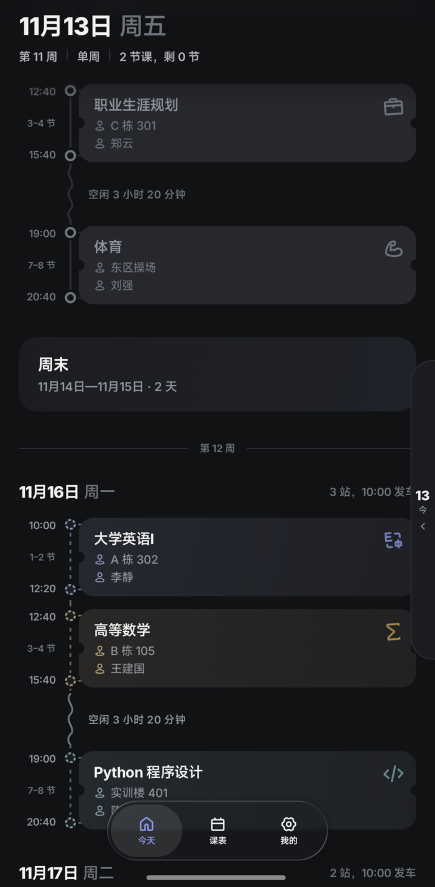
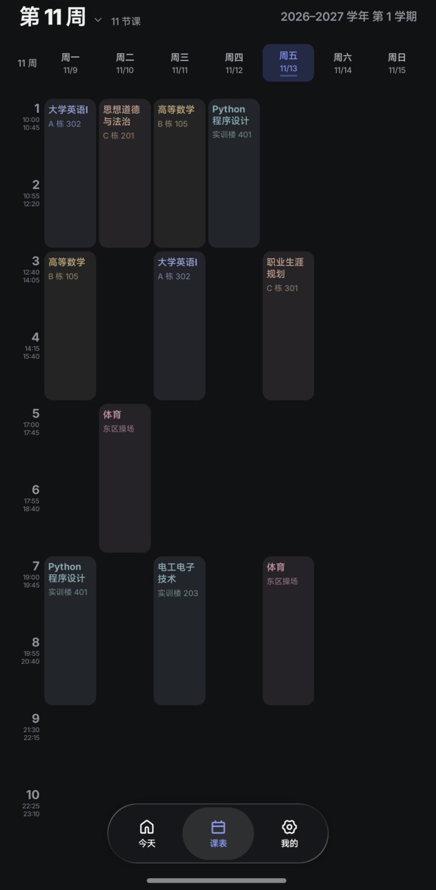
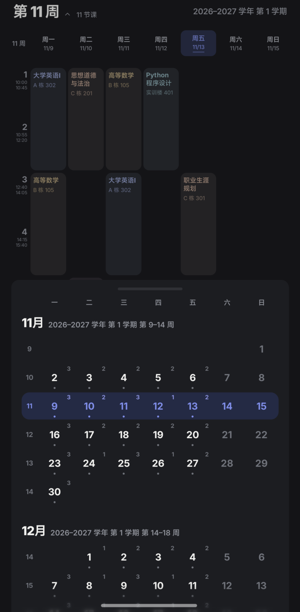
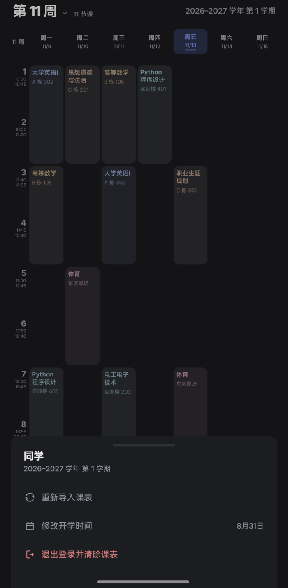

<p align="center">
  
</p>

<h1 align="center">Koma Pro</h1>

<p align="center"><strong>列车终将开往下一站，那舞台呢？我们呢？</strong></p>

<p align="center">课表应用。看今天上什么课、几点上下课、下一节去哪里。</p>

<table>
  <tr>
    <td><a href="docs/screenshots/home.png"></a></td>
    <td><a href="docs/screenshots/week.png"></a></td>
    <td><a href="docs/screenshots/calendar.png"></a></td>
    <td><a href="docs/screenshots/profile.png"></a></td>
  </tr>
  <tr>
    <td align="center">今天</td>
    <td align="center">课表</td>
    <td align="center">月历</td>
    <td align="center">我的</td>
  </tr>
</table>

## 安装

当前版本 0.2.0，包名 `moe.tnxg.koma`，只支持 Android 10 及以上系统。

没有上架应用商店，也没有发布 Release。手里有 APK 就传到手机安装；没有的话，按下面的「自己打包」自己编译。

## 第一次使用

1. 打开登录页（「新疆理工职业大学 · 统一身份认证」），输入学号、教务密码和验证码。验证码在本机用 ONNX 模型自动识别，识别错了可以换一张，也可以手动输入。
2. 登录后抓取整学期课表存在手机里，断网也能看。
3. 确认开学日期。它用来算「第几周」，之后可以在「我的」里修改。

之前用过旧版（WebView/Capacitor 版本）的用户，首次打开会自动迁入原课表，不会删掉旧数据。

## 怎么看课表

### 今天

一天的课程按时间轴排成一条线，标出开始和结束时间、教室、老师。课间空档直接写「空闲 3 小时 20 分钟」，不用自己算。换天、周末、下一周都有分隔。

屏幕右边缘有一枚日期把手。轻点或向左滑动展开日期条，向右滑动收起，6 秒无操作会自动收起。把手底部的月历按钮一直在，收起时也能直接打开月历。

### 课表

七列节次视图，整周一屏显示，不用上下滚动。左右滑动换周，今天那列会高亮。

点顶部周号可以打开月历；点上方某一天，回到那天行程。

### 月历

从屏幕底边升起，按周排列，显示第几周、每天几门课。可以选一整周，也可以选一天。

### 我的

头图、头像、学期进度和入口都在这一页。

- **个人资料**：改称呼；头像与封面可以从相册选择，选过之后就不再随机。自动生成的头像登录后固定，退出登录再登录才会换一个；随机封面在本机缓存三天。
- **教务账号**：重新导入课表，或退出登录并清除本机课表。
- **学期与课表**：看周次进度，改开学日期。
- **设置**：主题与强调色、课表显示、课程卡片、首页落点、课前提醒，都可一键恢复默认。
- **关于**：版本、开源协议、隐私与权限、开源许可、反馈问题。

设置和关于的每一页都能用左上角按钮、系统返回或从屏幕左缘右滑返回。

## 常见问题

| 遇到的情况 | 怎么办 |
| --- | --- |
| 周次对不上 | 到「我的」修改开学时间 |
| 课表有变动 | 到「我的」重新导入课表 |
| 验证码识别错了 | 换一张，或手动输入 |
| 登录提示被暂时锁定 | 密码连续输错会触发临时锁定，等 10–15 分钟再试；仍不行就到统一身份认证网页登录或联系网络信息中心解锁 |
| 某些节次没有钟点 | 课表里没配置时间的节次不显示钟点，应用不会猜 |
| 想清除课表 | 到「我的」退出登录并清除课表 |

## 隐私

课表保存在本机，账号凭据用 Android Keystore 加密保存在本机，验证码在本机识别。

没有广告，没有第三方统计。

## 自己打包

先装 [mise](https://mise.jdx.dev)，然后在仓库根目录执行：

```sh
mise trust
mise install
mise run setup
mise run build
```

Windows、macOS、Linux 用同一套命令。`mise run setup` 按平台分派：macOS / Linux 走 `tools/setup.sh`，Windows 走 `tools/setup.ps1`，装好 Android SDK（API 37、Build Tools 36.0.0 与 37.0.0、platform-tools）并按 SHA-256 校验 OCR 模型；Windows 只需要系统自带的 PowerShell，不用 WSL 或 Git Bash。

产物在 `app/build/outputs/apk/debug/app-debug.apk`，传到手机安装即可；连了设备也可以直接 `mise run run` 装上并启动。

## 反馈与源码

遇到问题请到 [GitHub Issues](https://github.com/TNXG/koma/issues) 反馈，源码仓库在 [https://github.com/TNXG/koma](https://github.com/TNXG/koma)。改代码请看 [开发说明](docs/DEVELOPMENT.md)。

## 开源协议

采用 AGPL-3.0 协议，版权归 TNXG 所有。
