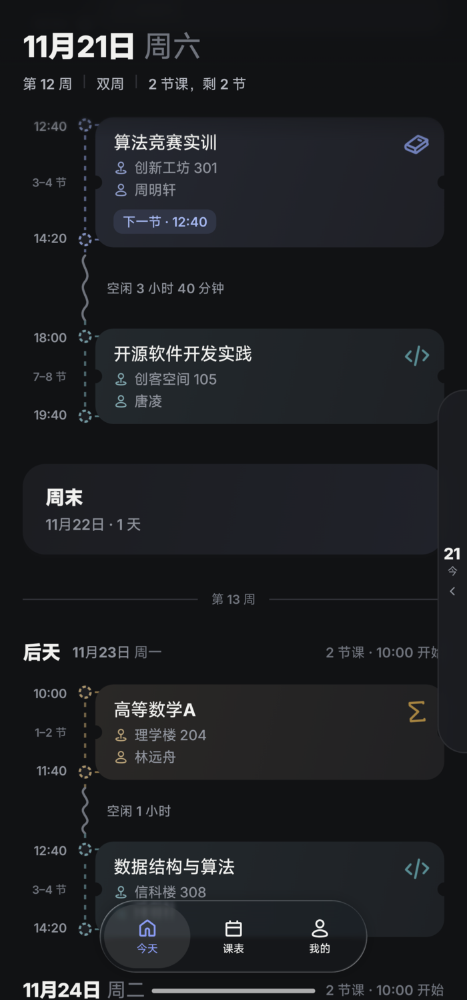
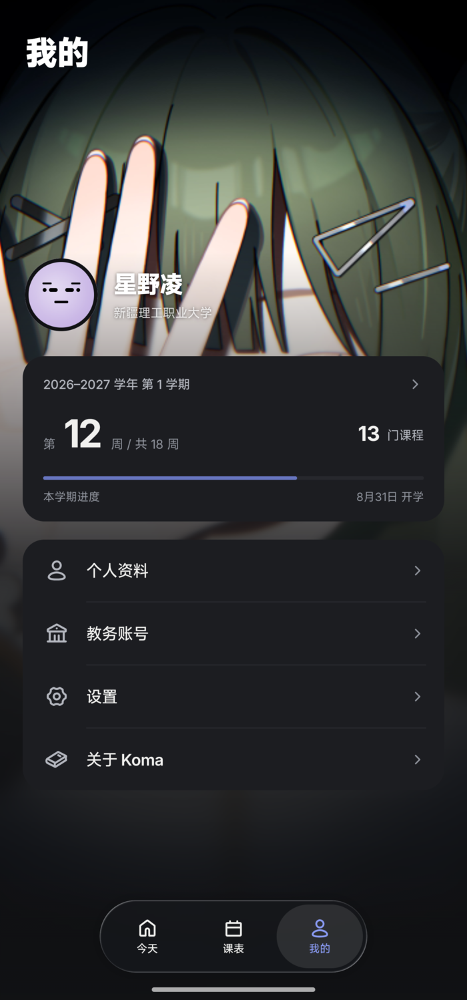

<p align="center">
  
</p>

<h1 align="center">Koma</h1>

<p align="center"><strong>列车终将开往下一站，那舞台呢？我们呢？</strong></p>

<p align="center">
  干净、克制、离线优先的大学课表应用。<br>
  看清今天每一节课、课间有多久空档、下一节去哪间教室。
</p>

<table>
  <tr>
    <td><a href="docs/screenshots/home.png"></a></td>
    <td><a href="docs/screenshots/week.png"></a></td>
    <td><a href="docs/screenshots/calendar.png"></a></td>
    <td><a href="docs/screenshots/profile.png"></a></td>
  </tr>
  <tr>
    <td align="center"><strong>今天</strong> · 日程时间轴</td>
    <td align="center"><strong>课表</strong> · 整周一屏</td>
    <td align="center"><strong>月历</strong> · 快速跳周</td>
    <td align="center"><strong>我的</strong> · 学期与偏好</td>
  </tr>
</table>

---

## 为什么用 Koma？

- **三种方式导入课表**：支持学校教务系统直连同步、粘贴或选择 JSON 离线课表，也可以让 AI 看课表截图自动整理导入。
- **本机自动识别验证码**：内置离线 OCR 模型，登录教务时在手机本地自动算完验证码，图片不上传任何服务器。
- **日程与周表双视图**：「今天」把课程与课间空档串成连续时间线；「课表」一屏排下整周节次，不用上下翻找。
- **自由调课与双层备注**：在周课表里点开任意课程，都能记课程简介或单周备忘、标记单周/全学期停课、单次调课改教室，或者删除课程。
- **同步不丢手动修改**：每天首次打开可自动同步教务最新排课；遇到你手动调过或记过备注的课，会保留你的修改或弹出冲突对照让你选。
- **纯粹、无打扰**：无广告、无第三方统计、无后台常驻推销，断网也能随时看课表。

---

## 下载与安装

- **系统要求**：Android 10（API 29）及以上，应用包名 `moe.tnxg.koma`。
- **获取安装包**：前往 [GitHub Releases](https://github.com/TNXG/koma/releases) 下载最新版本 APK。

每个版本提供按芯片架构拆分的安装包和通用包：

| 安装包文件名 | 适用设备 | 说明 |
| --- | --- | --- |
| `koma-<版本>-arm64-v8a.apk` | **绝大多数主流手机**（推荐） | 64 位 ARM 架构，体积最小 |
| `koma-<版本>-universal.apk` | 不确定型号时的稳妥选择 | 包含全部架构支持，体积稍大 |
| `koma-<版本>-armeabi-v7a.apk` | 较老的 32 位手机 | 32 位 ARM 架构 |
| `koma-<版本>-x86_64.apk` / `x86.apk` | 电脑模拟器、平板等 | x86 架构设备 |

> 旧版（WebView / Capacitor 版本）用户直接覆盖安装或首次打开新版时，应用会自动迁入原有课表与开学日期，无需重新配置。

---

## 导入你的第一份课表

第一次打开 Koma 时，你可以通过以下任意一种方式开始：

### 方式一：登录教务系统直连（已接入学校）

1. 在欢迎页点击 **「开始使用」**，搜索并选择你的学校（目前已接入 **新疆理工职业大学**）。
2. 输入**学号**和**统一身份认证密码**。
3. 应用会在本机自动识别验证码并抓取整学期课表（若连续 3 次自动识别未通过，会切换为手动输入算式得数）。
4. 核对或修改**第 1 教学周的周一日期**，点击「进入课表」即可。

开启「保存密码」后，下次同步或会话过期时会自动重登；你可以随时在「我的 → 教务账号」里退出并清除保存的密码。

### 方式二：用 AI 识图导入（适合任何学校）

如果你的学校暂未接入教务直连，或者手头只有课表截图/教务网页截图，可以让 AI 帮你转成 Koma 课表：

1. 在欢迎页点击 **「导入离线课表」**（或进入「我的 → 教务账号 → 导入课表」）。
2. 点击 **「用 AI 识图导入 → 复制提示词」**。
3. 把复制好的提示词和你的课表截图一起发给支持看图的 AI（如 ChatGPT、豆包、Kimi、通义千问等）。
   > **隐私提醒**：发送截图前，请先涂掉截图里的姓名、学号等个人信息。若截图中缺少开学日期、总周数或具体上下课钟点，AI 会先向你询问补齐。
4. 将 AI 回复的 JSON 全文复制并粘贴回 Koma，点击 **「预览课表」**，核对学期名称、第 1 周周一、总周数与课程门数后，点击 **「确认导入」**。

### 方式三：导入 JSON 文件或先随便看看

- **文件 / 文本导入**：在「导入课表」页可以直接点击「选择文件」读取 `.json` 课表文件，或粘贴已有的 Koma JSON v1 文本（应用内附带完整字段说明与示例）。
- **暂不登录**：在欢迎页点击「暂不登录」可直接进入空课表浏览界面与设置，你的选择会保存在本机，之后随时能去「我的」导入。

---

## 日常使用指南

### 1. 今天（日程时间轴）

把一整天的安排排成清晰的时间线：

- **看清节奏**：每张课程卡片标明上下课钟点、节次、教室和授课教师；正在上的课会高亮显示进度，下一节课会醒目标出「下一节 · 开课时间」。
- **课间空档不用算**：两节课之间相隔 40 分钟以上时，时间轴会直接标出「空闲 X 小时 X 分钟」；周末、无课日和跨周也会自然分隔。
- **右侧悬浮日期岛**：屏幕右边缘常驻一枚小巧的日期把手。
  - **轻点或左滑把手**：展开纵向日期条，上下滑动即可快速预览其他日期的日程，点「今」一键回到今天（松手 6 秒无操作自动收起）。
  - **点把手底部月历图标**：随时呼出底部月历，按月跨周跳转。

### 2. 课表（整周节次视图）

- **一屏看全周**：整周节次自适应屏幕高度，**无需上下滚动**就能看清全天排课；左右滑动即可翻看前后的教学周，当前正在上的时段会画出实时时间线。
- **快速跳周与回本周**：点击左上角「第 X 周」打开连续月历，每天有几节课一目了然，点选任意一行即可切到对应周。浏览其他周时，点击底部悬浮的 **「回本周」** 立即归位。
- **点星期回时间线**：点击表头上方的「周一 ~ 周日」，会直接切回「今天」时间轴并定位到那一天。

### 3. 备注、调课、停课与删除

在「课表」视图中**点击任意一门课**，会从底部升起课程详情抽屉：

- **双层课程备注**：
  - **课程简介**：全学期所有周次共享（适合记考核方式、教材、平时分占比）。
  - **本周备注**：仅对当前教学周生效（适合记随堂测验、交作业、带实验器材）。
- **单次调课**：临时换了时间或教室？点击「调课」即可把当前这一周的课移动到指定周次、星期、节次和地点，不影响其他周次。
- **停课与恢复**：支持「仅本周停课」或「全学期停课」，停课后不再触发该节的课前提醒，随时可以恢复。
- **删除课程**：支持「删除本节（仅移除当周这一次）」或「删除本课（移除全学期排课）」。所有改动均保存在本机，不会修改学校教务系统。
- **重叠课程切换**：同一时段若有单双周或冲突排课，抽屉内会展开「相关课程」列表，点击即可切换查看。

### 4. 自动同步与冲突保护

通过教务系统登录的课表，可以在 **「我的 → 教务账号」** 中管理更新：

- **每天自动更新**：开启「自动更新」后，每天首次打开应用会自动在后台检查教务课表变动；也可以随时点击「立即更新」。
- **手动修改优先保留**：你写过的备注、调过的课、设过的停课和删掉的课，**绝不会被自动同步静默覆盖**。当教务端排课发生变动并与你的本地修改冲突时，会弹出「课表同步冲突」对照卡片，由你逐条决定保留本机修改还是采用教务新排课。

### 5. 个性化设置与课前提醒

在 **「我的」** 页面中，你可以按自己的习惯定制 Koma：

- **个人资料**：自定义称呼；头像支持自动生成几何精灵头像（也可换一个）或从相册选图；主页背景封面默认每三天自动换一张插画，也可从相册自定义。
- **课表显示**：自由开关「显示周末」「显示非本周课程」，支持紧凑 / 标准 / 宽松三种排版密度，设置页顶部实时预览效果。
- **课程卡片**：可开关上课地点、授课教师展示，或在「课程彩色标识」与「中性卡片」之间切换。
- **主题与外观**：支持跟随系统 / 浅色 / 深色模式，提供**鸢尾蓝、晴空蓝、松石绿、蔷薇粉、琥珀金** 5 种强调色、4 档界面字号，以及「减少动态效果」开关。
- **首页与导航**：可设置每次启动应用时默认打开「今天」「课表」还是「我的」。
- **课前提醒**：开启后可在上课前（准时，或提前 5 / 10 / 15 / 30 分钟）发送系统通知提醒你去哪间教室上课。

---

## 常见问题

| 遇到的情况 | 解决办法 |
| --- | --- |
| **显示的周次和学校实际周次对不上** | 进入「我的 → 学期与课表 → 开学日期」，将第 1 周周一改为学校校历对应的周一即可。 |
| **老师临时调课、换教室或停课了** | 在「课表」页点开那节课，直接用「调课」或「停课」修改本机排课；如果教务系统已经更新，也可去「我的 → 教务账号」点「立即更新」或「重新导入课表」。 |
| **验证码自动识别没通过** | 自动识别连续尝试失败后会切换为手动输入，看图填算式结果即可；看不清可点击验证码图片刷新。 |
| **登录提示账号被暂时锁定** | 统一身份认证密码连续输错会触发学校端临时锁定，请等待 10–15 分钟后再试，或先在学校统一身份认证网页端登录解锁。 |
| **某些节次只显示第几节、没有具体钟点** | 导入的课表里未提供该节次的起止时间，Koma 不会自行猜测钟点；若用 JSON 导入，请在 `timeGrid` 中补全学校作息时间。 |
| **想换个账号或清空所有排课** | 进入「我的 → 教务账号」，点击底部的「退出登录并清除课表」（离线课表为「清除本地课表并返回欢迎页」）。 |

---

## 隐私与安全

Koma 把你的账号与个人数据完全留在你自己的设备上：

- **本地存储**：所有课表数据、备注、调课记录、自定义头像与偏好设置仅保存在本机。
- **凭据硬件级加密**：选择「保存密码」时，账号密码在 Android 上通过系统 **Keystore** 加密存储（在 HarmonyOS 实验端通过系统 **Asset Store** 加密，仅设备解锁时可访问且不跨设备同步）。
- **离线验证码识别**：登录验证码由打包在应用内的本地 ONNX 模型离线推理识别，验证码图片不会上传到任何第三方识别服务。
- **透明的网络请求**：除连接你所选学校的教务系统（如 `xjvut.edu.cn`）以及拉取随机封面/维护者头像（`api-space.tnxg.top`）外，不发起任何其他网络请求。无广告 SDK，无第三方统计与遥测。

你随时可以在应用内 **「我的 → 关于 Koma → 隐私与权限」** 查看当前设备的网络请求域、本机存储状态与系统权限说明。

---

## 从源码自己打包

如果你希望自己编译安装，只需先安装 [mise](https://mise.jdx.dev)，然后在仓库根目录依次执行：

```sh
mise trust
mise install
mise run setup
mise run build
```

Windows（原生 PowerShell）、macOS、Linux 使用同一套命令。`mise run setup` 会自动在项目目录内准备好固定版本的 JDK、Gradle、Android SDK 并校验本地 OCR 模型。

- 编译生成的安装包位于：`app/build/outputs/apk/debug/app-debug.apk`
- 若手机已通过 USB 连接电脑并开启调试，可直接运行 `mise run run` 一键安装并启动。
- 仓库内另附独立的 HarmonyOS 实验工程（`harmonySpike/`），架构细节、构建方式与新学校教务接入指南请参阅 **[开发说明](docs/DEVELOPMENT.md)**。

---

## 反馈与开源

- **问题反馈与建议**：遇到 Bug 或希望支持你的学校？欢迎提交 [GitHub Issues](https://github.com/TNXG/koma/issues)。
- **代码仓库**：源码同时托管在 [GitHub (TNXG/koma)](https://github.com/TNXG/koma) 与 [GitCode (gxdev_lab/koma)](https://gitcode.com/gxdev_lab/koma)，两边保持同步。
- **开源协议**：本项目遵循 [AGPL-3.0](LICENSE) 协议开源，版权归 GengXing Developer Lab & TNXG 所有。
